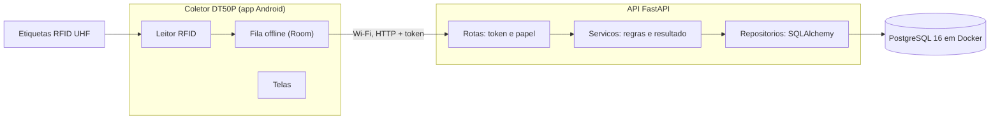
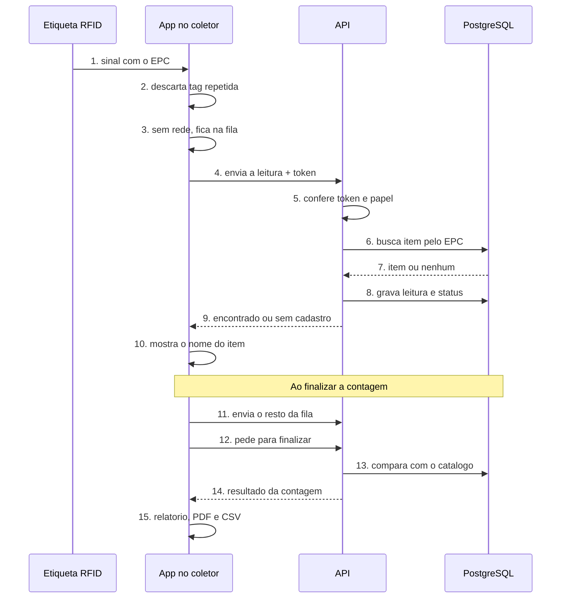
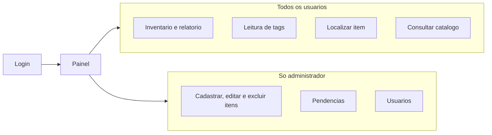

# TRI082 - Inventario com RFID

Sistema de controle de inventario por RFID feito para a TRI082. Cada peca recebe uma etiqueta RFID e o funcionario faz a contagem com um coletor Android, sem precisar ler item por item. No fim da contagem o sistema mostra o que era esperado, o que foi encontrado, o que esta faltando e as tags que nao tem cadastro.

O projeto tem duas partes:

- **API** (pasta raiz): FastAPI com banco PostgreSQL. Guarda o catalogo de itens, os usuarios, as leituras e as sessoes de inventario.
- **Aplicativo** (pasta `app-android`): app Android nativo em Java, feito para o coletor Urovo DT50P. Faz login, leitura das tags, inventario, localizacao de item pelo sinal, catalogo, pendencias de cadastro, relatorios e painel.

Desenvolvido por Marco Albuquerque e Ulysses Bomfim.

Videos dos testes no laboratorio: [Google Drive](https://drive.google.com/drive/folders/1FvxYGKDzV0dRTUSCvFKgV5qEK8fqE3ZB?usp=sharing)

## Contexto

Hoje a TRI082 faz o inventario de materias-primas (rolos de tecido e latas de tinta) de forma manual. O processo leva cerca de tres dias e gera divergencias entre o estoque fisico e o sistema. Uma prova de conceito anterior mostrou que o coletor consegue ler as etiquetas em lote. Este MVP transforma essa leitura em um fluxo de informacao real, com catalogo, sessoes de inventario, relatorios e controle de acesso.

Como as etiquetas usadas nao tem memoria gravavel, cada peca e identificada pelo codigo EPC nativo da propria tag.

## Arquitetura

O coletor so le e mostra. Quem decide se uma tag e um item conhecido e quem calcula o resultado da contagem e a API.



Dentro da API, cada requisicao passa por rotas, servicos e repositorios, e so os repositorios acessam o banco.

## Fluxo de um inventario



O passo 3 so acontece sem rede: a leitura espera no aparelho e segue do passo 4 quando a conexao volta. As tags que voltam como sem cadastro aparecem em Pendencias para o administrador cadastrar ou ignorar.

## Fluxo do usuario



O funcionario faz a operacao do dia a dia. O administrador faz tudo isso e tambem mantem o catalogo, resolve pendencias e gerencia as contas. Quando o funcionario le uma tag sem cadastro, ela vira uma pendencia para o administrador.

## Funcionalidades

| Funcionalidade | O que faz | Quem usa |
| --- | --- | --- |
| Login e papeis | Entrada com usuario e senha; cada papel ve so as telas permitidas | Todos |
| Leitura de tags | Leitura pelo gatilho do coletor, com nome do item quando cadastrado e busca na lista | Todos |
| Inventario | Iniciar a contagem, ler as pecas na propria tela e finalizar | Todos |
| Relatorio | Esperados, encontrados, ausentes e nao identificados, com historico das contagens anteriores | Todos |
| Exportacao | Relatorio em PDF ou CSV salvo no coletor | Todos |
| Localizar item | Medidor de proximidade pelo sinal RSSI da tag, com aviso de sinal perdido e de queda de internet | Todos |
| Fila offline | Leituras guardadas no aparelho quando a rede cai e enviadas depois | Todos |
| Painel | Indicadores e dashboard de 7, 30 ou 90 dias com a ultima contagem | Todos |
| Catalogo | Busca, detalhe, cadastro, edicao e exclusao de itens | Consulta: todos. Alteracao: administrador |
| Pendencias | Tags lidas sem cadastro, com opcao de cadastrar ou ignorar e busca por EPC | Administrador |
| Usuarios | Criar contas, trocar papel e senha, ativar e desativar, sempre com um administrador ativo | Administrador |

## Tecnologias

| Parte | Tecnologia | Para que serve |
| --- | --- | --- |
| Hardware | Coletor Urovo/Identix DT50P (Android, leitor RFID UHF) | Ler as etiquetas em lote |
| Hardware | Etiquetas RFID UHF passivas | Identificar cada peca pelo EPC |
| API | Python 3.13 e FastAPI | Servidor e rotas, com documentacao interativa automatica |
| API | PostgreSQL 16 | Banco de dados |
| API | SQLAlchemy e Alembic | Acesso ao banco sem SQL manual e versionamento da estrutura |
| API | Pydantic | Validacao de todos os dados recebidos |
| API | JWT (PyJWT) e bcrypt | Login por token e senhas protegidas |
| Infraestrutura | Docker e Docker Compose | Subir o banco com um comando |
| Aplicativo | Java 17 e Android SDK 35 (minimo Android 7) | Aplicativo nativo do coletor |
| Aplicativo | Material Design 3 e Navigation | Interface e navegacao entre telas |
| Aplicativo | Retrofit, OkHttp e Gson | Comunicacao com a API |
| Aplicativo | Room | Fila offline de leituras no aparelho |
| Aplicativo | AndroidX Security Crypto | Guardar token e papel criptografados |
| Aplicativo | URFIDLibrary (SDK da Urovo) | Controle do leitor RFID |

## Modelo de dados

| Tabela | O que guarda | Campos principais |
| --- | --- | --- |
| usuarios | Quem usa o sistema | nome de usuario, hash da senha, papel, ativo |
| itens | Catalogo de materiais | EPC (unico), nome, categoria, tipo, cor, fornecedor, status |
| sessoes_inventario | Cada contagem | status (aberta ou finalizada), inicio, fim, quem criou e quem finalizou |
| leituras | Cada tag lida numa contagem | sessao, EPC, item (pode ser vazio), status, data e hora, operador |
| tags_ignoradas | Tags marcadas como "nao e produto" | EPC, quando foi ignorada, por quem |

Itens e usuarios nunca sao apagados de fato: itens recebem status excluido e usuarios sao desativados, para manter o historico das contagens.

## Testes no laboratorio

| Teste | Como foi feito | Resultado |
| --- | --- | --- |
| Inventario completo | Tags cadastradas espalhadas pelo laboratorio, algumas fora da sala e algumas sem cadastro | Relatorio bateu com o esperado |
| Leitura dentro de armario | Tags espalhadas dentro de um armario fechado, lidas pelo lado de fora | Tags lidas e contadas no inventario |
| Alcance de leitura | Coletor afastado da tag ate perder o sinal, usando a tela Localizar | Leu a mais de 9 m de distancia |
| Busca de tag escondida | Uma tag escondida e procurada so pelo medidor da tela Localizar | Tag encontrada seguindo o aumento do sinal |
| Leitura em lata de tinta | Etiqueta colada direto na lata e com um papel de 3 a 5 mm entre ela e o metal | Com o papel como espacador leu normalmente; colada direto no metal nao le |
| Fila offline | Wi-Fi do coletor desligado no meio da contagem e religado depois | Leituras enviadas quando a rede voltou, sem perda |
| Cadastro durante a contagem | Tag desconhecida cadastrada antes de finalizar | Passou a contar como encontrada |
| Controle de acesso | Mesmas telas abertas com administrador e com funcionario | Funcionario nao acessa cadastro, pendencias nem usuarios |
| Exportacao | Relatorio salvo em PDF e CSV e aberto no computador | Arquivos abriram corretamente, CSV direto no Excel |

Em embalagens metalicas, a etiqueta precisa de um espacador (ou de uma etiqueta propria para metal) para ser lida.

## Limitacoes do MVP

Estes pontos ficaram de fora de proposito, por se tratar de um MVP:

- **Rede local:** a API roda em um computador da mesma rede Wi-Fi do coletor, sem HTTPS.
- **Sem sistema web:** todo o uso e pelo coletor. Os relatorios chegam ao computador pela exportacao em PDF ou CSV.
- **Sem integracao com ERP:** o catalogo e cadastrado no proprio sistema.
- **Sem quantidade em estoque:** cada tag representa uma peca.
- **Esperados = catalogo inteiro:** toda contagem compara com todos os itens ativos, sem contagem por setor ou local.
- **Localizacao aproximada:** o medidor mostra se o operador esta mais perto ou mais longe da tag, nao a distancia em metros.
- **Seguranca basica:** sem limite de tentativas de login, sem criptografia dos dados no banco e sem auditoria completa.

Previsto para evolucoes futuras: sistema web com dashboard, integracao com o ERP, seguranca para producao (HTTPS, limite de requisicoes, criptografia e auditoria), uso do modulo 4G do coletor e troca de senha pelo proprio usuario.

## O que precisa ter instalado

Para a API:

- Python 3.13
- Docker Desktop (usado so para rodar o PostgreSQL)
- Git

Para o aplicativo:

- Android Studio (versao recente, com JDK 17 e Android SDK 35)
- Um coletor Urovo DT50P para ler as tags. O app abre em outros celulares e no emulador, mas a leitura RFID so funciona no coletor.

A biblioteca do leitor RFID (`URFIDLibrary`) ja vem no repositorio, em `app-android/app/libs`.

## Como rodar a API

Os comandos abaixo sao para o terminal do Windows, dentro da pasta do projeto.

1. Baixe o projeto:

```bash
git clone https://github.com/Albuqmarq/TRI082.git
cd TRI082
```

2. Crie o ambiente virtual e instale as dependencias:

```bash
python -m venv .venv
.venv\Scripts\python.exe -m pip install -r requirements.txt
```

3. Crie o arquivo `.env` a partir do exemplo. Troque o valor de `SECRET_KEY` por qualquer texto longo e aleatorio:

```bash
copy .env.example .env
```

4. Com o Docker Desktop aberto, suba o banco:

```bash
docker compose up -d
```

5. Crie as tabelas:

```bash
.venv\Scripts\alembic.exe upgrade head
```

6. Cadastre os usuarios e alguns itens de teste:

```bash
.venv\Scripts\python.exe popular_banco.py
```

7. Rode a API liberada para a rede, para o coletor conseguir acessar:

```bash
.venv\Scripts\python.exe -m uvicorn app.main:app --host 0.0.0.0 --port 8000
```

Para conferir se esta funcionando, abra http://localhost:8000/docs no navegador. Essa pagina lista todas as rotas e permite testar cada uma.

Para desligar o banco depois, use `docker compose down`. Os dados continuam salvos para a proxima vez.

## Como rodar o aplicativo

1. Abra a pasta `app-android` no Android Studio e espere o Gradle terminar de sincronizar.
2. No coletor, ative o modo desenvolvedor e a depuracao USB, e ligue ele no computador pelo cabo.
3. Escolha o coletor na lista de aparelhos e clique em Run.

Se preferir gerar o APK pelo terminal, dentro da pasta `app-android`:

```bash
gradlew.bat assembleDebug
```

O arquivo fica em `app-android/app/build/outputs/apk/debug/app-debug.apk`.

## Ligando o app na API

O coletor e o computador que roda a API precisam estar na mesma rede Wi-Fi.

1. No computador, descubra o IP com o comando `ipconfig` (linha "Endereco IPv4" do adaptador Wi-Fi).
2. Na tela de login do app, toque em **Configurar servidor**, informe esse IP e a porta `8000` e salve.
3. Entre com um dos usuarios de teste.

No emulador do Android Studio, use o IP `10.0.2.2`, que aponta para o proprio computador.

Se o app nao conectar, abra `http://IP-DO-COMPUTADOR:8000/docs` no navegador do coletor. Se a pagina nao abrir, o problema e de rede ou do firewall do Windows, que precisa liberar a porta 8000.

## Usuarios de teste

Criados pelo script `popular_banco.py`:

- admin / admin123 (administrador)
- funcionario / func123 (funcionario)

O administrador ve todas as telas, inclusive cadastro de itens, pendencias e usuarios. O funcionario faz leitura, inventario e localizacao.
